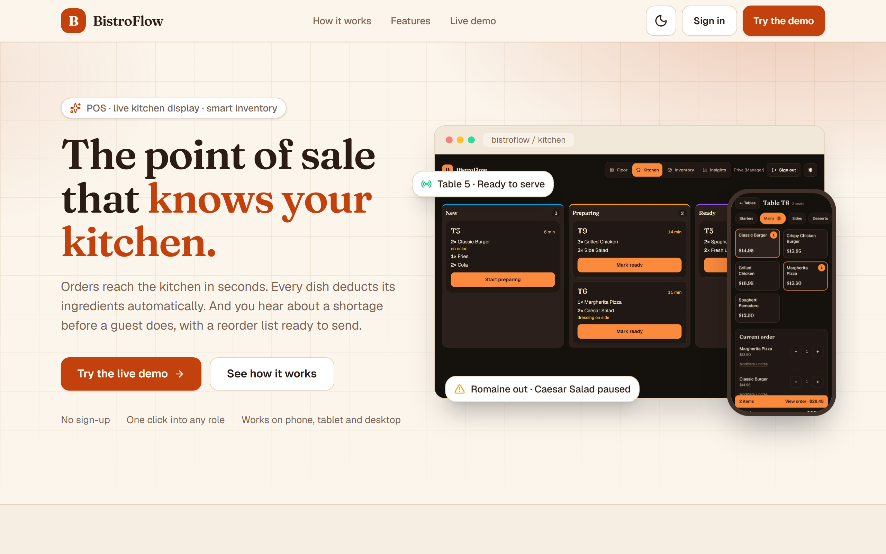
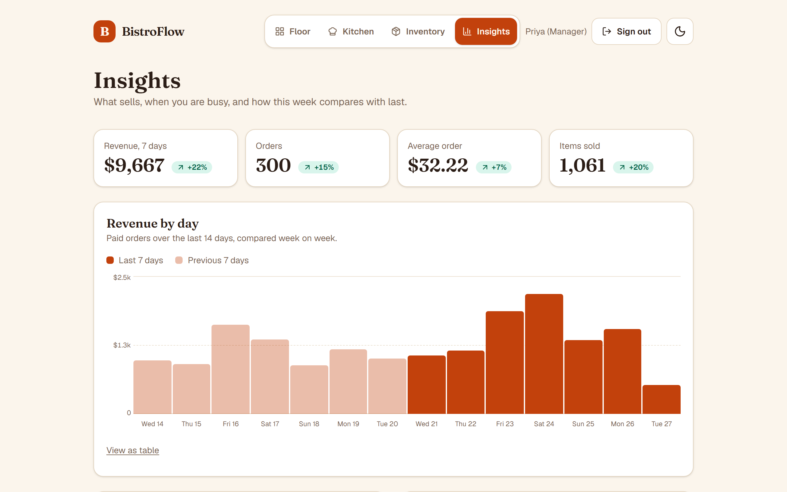
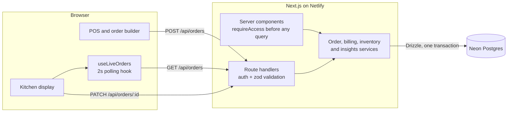

# BistroFlow

[](https://github.com/brandigail/bistroflow/actions/workflows/ci.yml)

**The point of sale that knows your kitchen.** Waiters take orders on a table map, the kitchen works tickets on a live board, every order deducts stock inside a single database transaction, and managers get a reorder list and sales insights, so a restaurant knows what is cooking, what is left and what to buy before the shift runs dry.

> **Live demo: [bistroflow-830.netlify.app](https://bistroflow-830.netlify.app)** &nbsp;·&nbsp; one click into any role, no sign-up (see [Roles](#roles-and-demo-logins))

<p align="center">
  
</p>

## Why BistroFlow exists

A small restaurant usually runs on three things that don't talk to each other: orders shouted or scribbled to the kitchen, a till, and a stockroom nobody counts until a dish runs out mid-service. The result is slow tickets, wrong orders, and a guest hearing "sorry, we're out of that" *after* they've ordered, plus food waste from guessing what to buy.

BistroFlow connects **order → kitchen → stock** in one loop.

| Without it | With BistroFlow |
|---|---|
| Orders walk or shout to the kitchen | The ticket reaches the kitchen board in about 2 seconds, and the waiter sees when it is ready |
| "We're out of that" after the guest orders | The menu shows **Only 3 left** or **Sold out** *before* the order is taken, computed from live stock and recipes |
| A stock count once a week, by gut | Every order deducts its ingredients automatically, in the same database transaction |
| Reordering from memory | A **reorder list** with suggested quantities, the dishes each shortage affects, a copy-ready supplier order, and one tap to record the delivery |
| No idea what sells | **Insights**: revenue by day against last week, best sellers and busiest hours |

## Demo it in 60 seconds

1. On the landing page, click **Enter as waiter**. Open a free table, build an order with modifiers ("no onion"), and tap **Send to kitchen**.
2. In a second window, click **Enter as kitchen**. The ticket appears within about 2 seconds with no refresh. Tap **Start preparing**, then **Mark ready**.
3. Back as the waiter, serve the ticket, then **Take payment**. The table frees up.
4. Click **Enter as manager** and open **Inventory**. The demo starts with Romaine out, so Caesar Salad shows **Sold out** on the order screen. Edit the suggested quantities, **Copy supplier order**, then **Receive delivery**: the alert clears and Caesar Salad can be ordered again. Then open **Insights**.

Visitors can't break it for long: managers have a **Reset demo data** button (Insights page) that restores the starting state, including two weeks of sales history.

## Features

- **Landing page with one-click demo entry** for each role.
- **POS:** colour-coded table map with live stats, menu by course, order builder with per-category modifiers, live running total, and a mock payment flow that frees the table.
- **Kitchen display (`/kds`):** tickets in New, Preparing and Ready columns that update live, with ticket ages that turn amber and red as they wait.
- **Stock-aware menu:** each dish shows how many portions the current stock can still make (limited by its scarcest ingredient). Low dishes warn, sold-out dishes are disabled, and an order can't exceed what is left.
- **Inventory and reordering:** every order deducts its ingredients transactionally. Ingredients at or below their reorder level go on a **reorder list** that shows which dishes they affect, suggests an order quantity (editable), copies a supplier-ready order, and records the delivery in one tap.
- **Insights:** revenue, orders, average order and items sold with week-on-week change, a 14-day revenue chart, best sellers and a busiest-hours chart, with hover tooltips and a table view for each chart.
- **Roles:** waiter, kitchen and manager logins with permissions enforced server-side.
- **Polish:** light and dark themes, mobile-first layout checked from 375px to desktop, 44px touch targets, consistent hover, press and focus states, skip link, reduced-motion support.

<p align="center">
  
  
</p>
<p align="center">
  
  
</p>
<p align="center">
  
  
</p>
<p align="center">
  
  
  
  
</p>

## Roles and demo logins

| Person | PIN | Lands on | Can do |
|---|---|---|---|
| Maya (Waiter) | `1111` | Floor | Take orders, take payment, mark Ready tickets as Served |
| Luca (Kitchen) | `2222` | Kitchen display | Move tickets New → Preparing → Ready |
| Priya (Manager) | `3333` | Floor | Everything, plus Inventory, Insights and demo reset |

The landing page signs you in with one click, so you never need the PINs. They are stored as bcrypt hashes and published only because this is a public demo.

## How it works



### Engineering decisions worth a look

- **Inventory can't go wrong.** Placing an order runs in one transaction: each ingredient is decremented with `UPDATE … WHERE stock >= needed`, so an order that would overdraw stock fails and rolls back completely, including stock already deducted for earlier ingredients. Ingredients are locked in a fixed order to avoid deadlocks, and a `CHECK (stock >= 0)` constraint is the last line of defence. Receiving a delivery follows the same rules. See [place-order.ts](features/orders/place-order.ts).
- **No skipped or double-applied ticket states.** Status changes are compare-and-set (`UPDATE … WHERE status = <previous>`), so two screens tapping the same ticket cannot jump a state. See [advance-order.ts](features/orders/advance-order.ts).
- **Live updates without WebSockets.** Netlify Functions can't hold persistent connections, so all realtime goes through one hook, [use-live-orders.ts](features/orders/use-live-orders.ts). It polls every 2 s, never overlaps requests, pauses in hidden tabs and keeps the last good data on a network error. Swapping in SSE later touches only that file.
- **Authorization next to the data.** Every server component that reads data calls [`requireAccess`](lib/access.ts) before it queries, and every API handler re-checks the role. There is deliberately no middleware layer: Next.js documents it as suitable only for optimistic checks, and keeping the guard beside the query means nothing is fetched for someone who shouldn't see it. The whole permission matrix lives in one small, unit-tested module: [permissions.ts](lib/permissions.ts).
- **A stable, resettable demo.** Demo staff have fixed ids, so open sessions and login pages survive a reset. The seeder uses bulk inserts and a single truncate, so the manager's reset button finishes in about a second inside a serverless function.
- **Money is integer cents** in the database and summed in cents, converting to dollars only for display.
- **Next.js 16 `cacheComponents`:** live data renders at request time behind `connection()` and `Suspense`, with skeletons, so the build never needs a database.

## Stack

Next.js 16 (App Router) · TypeScript (strict, no `any`) · Tailwind CSS v4 · Drizzle ORM · Neon Postgres (`@neondatabase/serverless`) · Auth.js v5 (Credentials, JWT sessions) · zod · bcryptjs · lucide-react · Vitest · Netlify

## Run locally

You need Node 22+ and a free [Neon](https://neon.com) project.

```bash
npm install
cp .env.example .env.local     # then fill in DATABASE_URL, DATABASE_URL_UNPOOLED and AUTH_SECRET
npm run db:migrate             # create the tables
npm run db:seed                # menu, recipes, tables, staff, live orders and two weeks of sales
npm run dev                    # http://localhost:3000
```

Deploying to Netlify needs `DATABASE_URL`, `AUTH_SECRET` and `AUTH_TRUST_HOST=true` as environment variables.

| Script | What it does |
|---|---|
| `npm run dev` / `build` / `start` | Next.js dev server, production build, production server |
| `npm run lint` · `npm run typecheck` · `npm test` | ESLint, `tsc --noEmit`, Vitest |
| `npm run db:generate` / `db:migrate` | Generate and apply Drizzle migrations (direct connection) |
| `npm run db:seed` | Reset and reload the demo data (stock, orders, sales history) |

CI ([.github/workflows/ci.yml](.github/workflows/ci.yml)) runs lint, typecheck, tests and the build on every push.

## Project structure

```
app/            routes: landing, /floor, /pos/[tableId], /kds, /inventory, /insights, /login, /api/*
features/       auth · billing · insights · inventory · kds · landing · menu · orders · pos · tables
components/     shared UI (header, brand mark, theme toggle)
db/             Drizzle schema and client, demo data and the seeder
drizzle/        generated SQL migrations
lib/            permissions, page access guard, zod schemas, formatting, API auth helpers
types/          shared TypeScript interfaces
scripts/        seed script
```

## Phase 2

Split bills · daily sales report with CSV export · persisted purchase orders with suppliers and delivery history · persisted payments and price snapshots on order lines · SSE transport for the live hook · rate limiting on PIN attempts · receiving deliveries for any ingredient, not just those on the reorder list.

## Status

MVP, landing page and insights complete. Live on Netlify, with a green CI pipeline.
