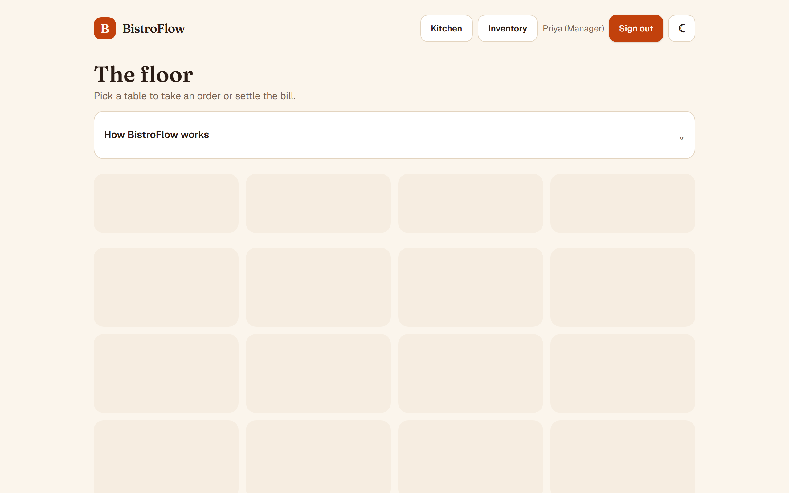
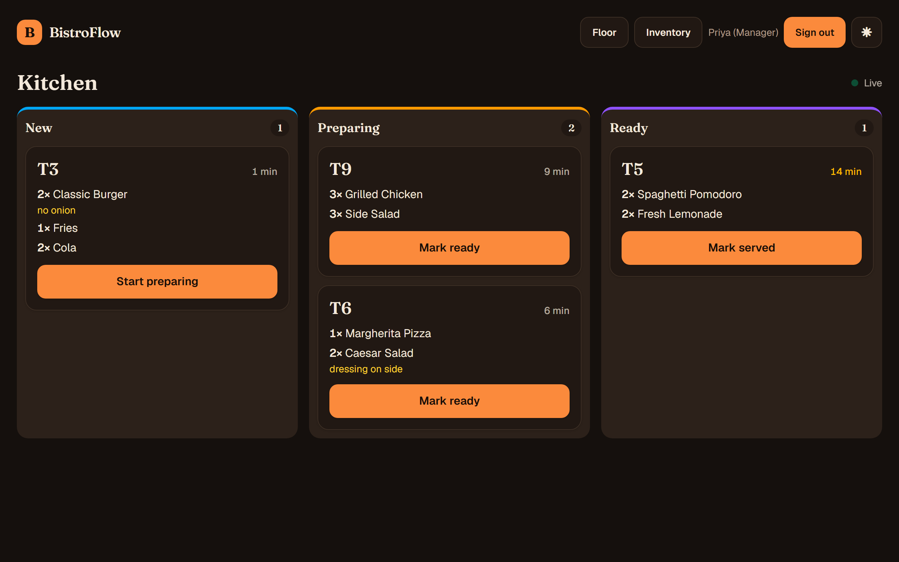
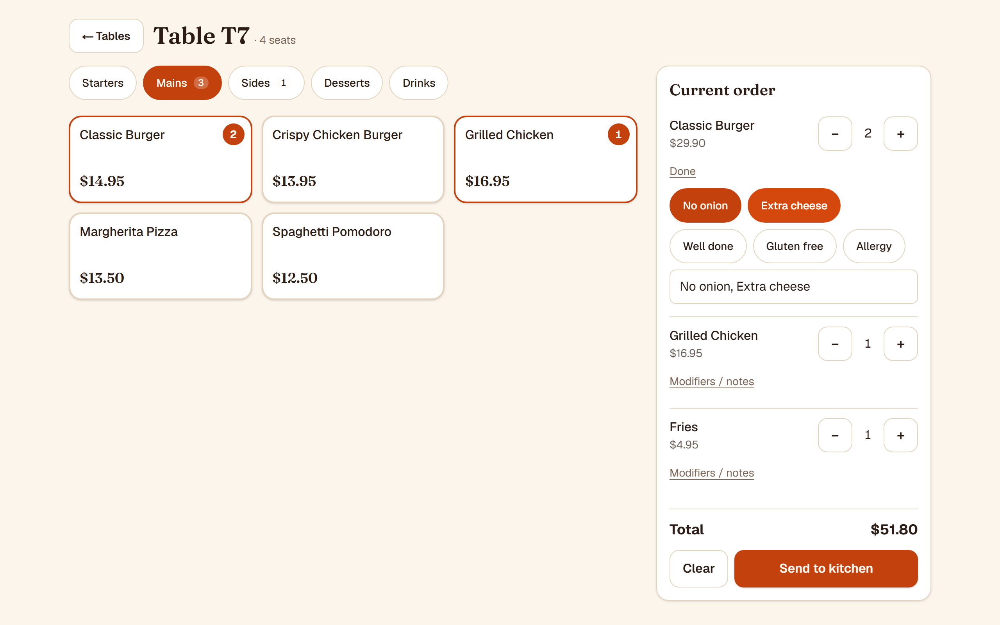
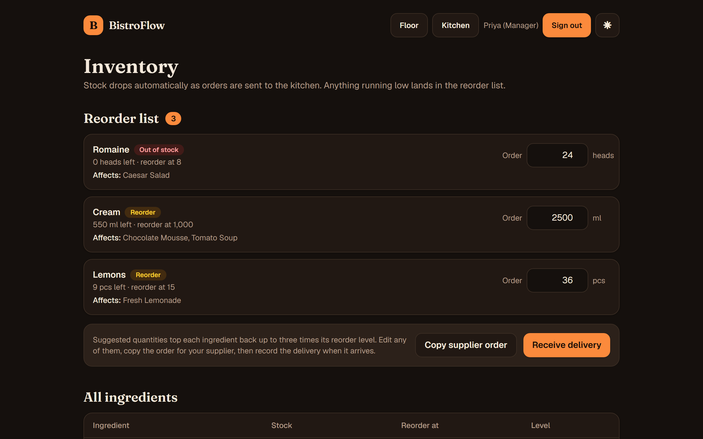
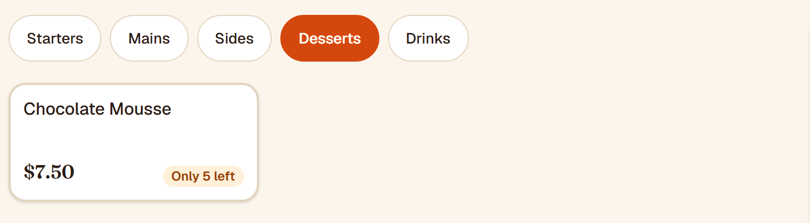
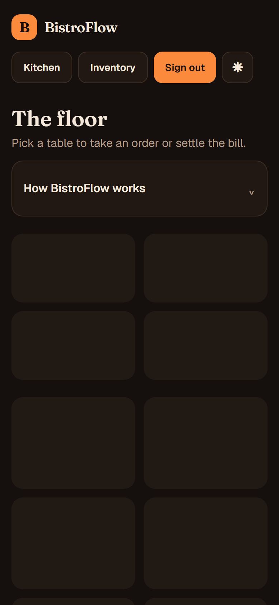
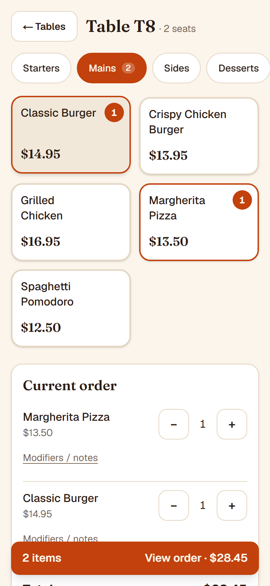
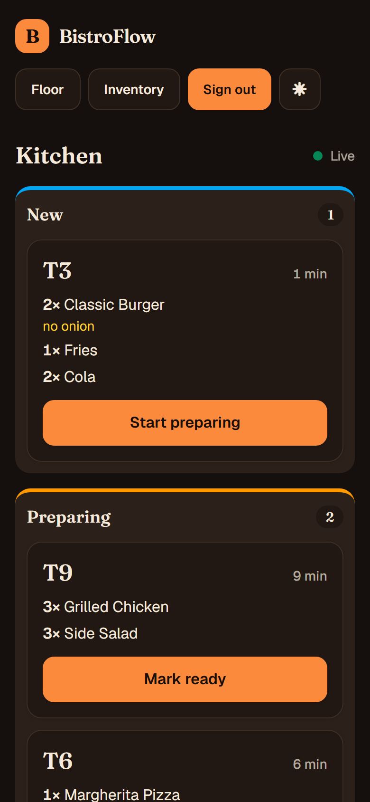
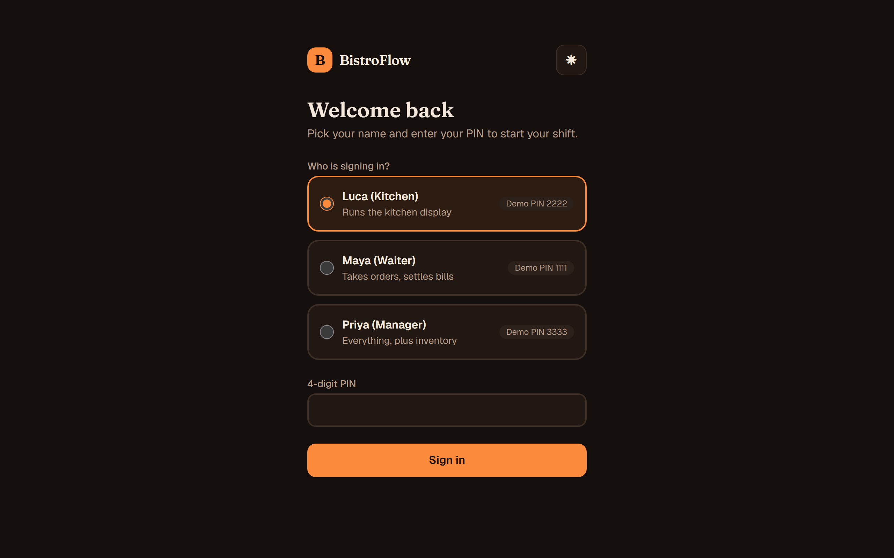
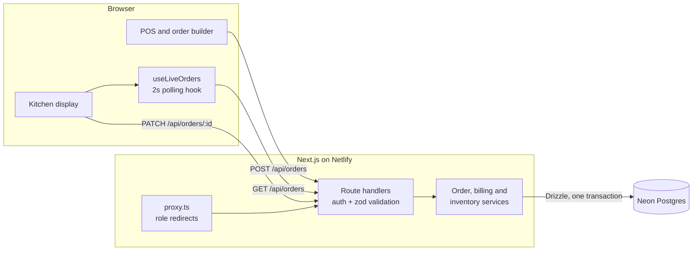

# BistroFlow

[](https://github.com/brandigail/bistroflow/actions/workflows/ci.yml)

**A restaurant point-of-sale with a live kitchen display and ingredient-level inventory.** Waiters take orders on a table map, the kitchen works tickets on a live board, and every order deducts stock inside a single database transaction, so inventory never lies.

> **Live demo:** TBD &nbsp;·&nbsp; **Sign in with any demo PIN** (see [Roles](#roles-and-demo-logins))

<p align="center">
  
  
</p>

## Why BistroFlow exists

A small restaurant usually runs on three things that don't talk to each other: orders shouted or scribbled to the kitchen, a till, and a stockroom nobody counts until a dish runs out mid-service. The result is slow tickets, wrong orders, and a guest hearing "sorry, we're out of that" *after* they've ordered, plus food waste from guessing what to buy.

BistroFlow connects **order → kitchen → stock** in one loop, so the restaurant always knows what is being cooked, what is left, and what to buy before the shift runs dry.

| Without it | With BistroFlow |
|---|---|
| Orders walk or shout to the kitchen | The ticket reaches the kitchen board in about 2 seconds, and the waiter sees when it is ready |
| "We're out of that" after the guest orders | The menu shows **Only 3 left** or **Sold out** *before* the order is taken, because it is computed from live stock and recipes |
| A stock count once a week, by gut | Every order deducts its ingredients automatically, in the same database transaction |
| Reordering from memory | A **reorder list** with suggested quantities, the dishes each shortage affects, a copy-ready supplier order, and one tap to record the delivery |

## Demo it in 60 seconds

1. **Sign in as Maya (Waiter, PIN 1111)**, open a free table, build an order with modifiers ("no onion"), and tap **Send to kitchen**.
2. **Open a second window as Luca (Kitchen, PIN 2222).** The ticket appears within about 2 seconds with no refresh. Tap **Start preparing**, then **Mark ready**.
3. **Back as Maya**, serve the ticket, then **Take payment**. The table frees up.
4. **Sign in as Priya (Manager, PIN 3333)** and open **Inventory**. The demo starts with Romaine out, so Caesar Salad shows **Sold out** on the order screen. Edit the suggested quantities, **Copy supplier order**, then **Receive delivery**: the alert clears and Caesar Salad can be ordered again.

## Features

- **POS:** colour-coded table map, menu by course, order builder with per-category modifiers, live running total, and a mock payment flow that frees the table.
- **Stock-aware menu:** each dish shows how many portions the current stock can still make (limited by its scarcest ingredient). Low dishes warn, sold-out dishes are disabled, and an order can't exceed what is left.
- **Kitchen display (`/kds`):** tickets in New, Preparing and Ready columns that update live, with ticket ages that turn amber and red as they wait.
- **Inventory and reordering:** recipes link every dish to its ingredients and each order deducts stock transactionally. Ingredients at or below their reorder level go on a **reorder list** that shows which dishes they affect, suggests an order quantity (editable), copies a supplier-ready order, and records the delivery in one tap.
- **Roles:** waiter, kitchen and manager PIN logins with permissions enforced server-side.
- **Polish:** light and dark themes, mobile-first layout checked from 375px to desktop, 44px touch targets, skip link, keyboard-visible focus, reduced-motion support.

<p align="center">
  
  
</p>
<p align="center">
  
</p>
<p align="center">
  
  
  
  
</p>

## Roles and demo logins

| Person | PIN | Lands on | Can do |
|---|---|---|---|
| Maya (Waiter) | `1111` | Floor | Take orders, take payment, mark Ready tickets as Served |
| Luca (Kitchen) | `2222` | Kitchen display | Move tickets New → Preparing → Ready |
| Priya (Manager) | `3333` | Floor | Everything, plus Inventory |

PINs are stored as bcrypt hashes and shown on the login screen only because this is a public demo.

## How it works



### Engineering decisions worth a look

- **Inventory can't go wrong.** Placing an order runs in one transaction: each ingredient is decremented with `UPDATE … WHERE stock >= needed`, so an order that would overdraw stock fails and rolls back completely, including stock already deducted for earlier ingredients. Ingredients are locked in a fixed order to avoid deadlocks, and a `CHECK (stock >= 0)` constraint is the last line of defence. See [place-order.ts](features/orders/place-order.ts).
- **No skipped or double-applied ticket states.** Status changes are compare-and-set (`UPDATE … WHERE status = <previous>`), so two screens tapping the same ticket cannot jump a state. See [advance-order.ts](features/orders/advance-order.ts).
- **Live updates without WebSockets.** Netlify Functions can't hold persistent connections, so all realtime goes through one hook, [use-live-orders.ts](features/orders/use-live-orders.ts). It polls every 2 s, never overlaps requests, pauses in hidden tabs and keeps the last good data on a network error. Swapping in SSE later touches only that file.
- **Authorization in three layers.** `proxy.ts` redirects pages, server components re-check the session, and every API handler enforces the role again (the Next.js docs are explicit that the proxy alone isn't enough). The whole permission matrix lives in one small, unit-tested module: [permissions.ts](lib/permissions.ts).
- **Money is integer cents** in the database and summed in cents, converting to dollars only for display.
- **Next.js 16 `cacheComponents`:** live data renders at request time behind `connection()` and `Suspense`, with skeletons, so the build never needs a database.

## Stack

Next.js 16 (App Router) · TypeScript (strict, no `any`) · Tailwind CSS v4 · Drizzle ORM · Neon Postgres (`@neondatabase/serverless`) · Auth.js v5 (Credentials, JWT sessions) · zod · bcryptjs · Vitest · Netlify

## Run locally

You need Node 22+ and a free [Neon](https://neon.com) project.

```bash
npm install
cp .env.example .env.local     # then fill in DATABASE_URL, DATABASE_URL_UNPOOLED and AUTH_SECRET
npm run db:migrate             # create the tables
npm run db:seed                # menu, recipes, tables, staff and a few in-flight orders
npm run dev                    # http://localhost:3000
```

| Script | What it does |
|---|---|
| `npm run dev` / `build` / `start` | Next.js dev server, production build, production server |
| `npm run lint` · `npm run typecheck` · `npm test` | ESLint, `tsc --noEmit`, Vitest |
| `npm run db:generate` / `db:migrate` | Generate and apply Drizzle migrations (direct connection) |
| `npm run db:seed` | Reset and reload the demo data (also restores stock and re-creates logins) |

CI ([.github/workflows/ci.yml](.github/workflows/ci.yml)) runs lint, typecheck, tests and the build on every push.

## Project structure

```
app/            routes: floor, /pos/[tableId], /kds, /inventory, /login, /api/*
features/       auth · billing · inventory · kds · menu · orders · pos · tables (components, queries, services)
components/     shared UI (header, brand mark, theme toggle)
db/             Drizzle schema and client
drizzle/        generated SQL migrations
lib/            permissions, zod schemas, formatting, API auth helpers
types/          shared TypeScript interfaces
scripts/        seed script
```

## Phase 2

Split bills · daily sales report with CSV export · persisted purchase orders with suppliers and delivery history · persisted payments and price snapshots on order lines · SSE transport for the live hook · rate limiting on PIN attempts.

## Status

MVP complete (POS, kitchen display, inventory, roles). Pending: Netlify deployment and live URL.
